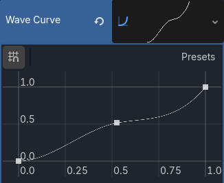

# Goals/Tasks

I didn't necessarily have a set goal to tackle this week, so from our issues, I chose to spend some time working on infinite/procedural wave generation.

## Wave Generation Using Curves

Dr. Faas had suggested a few weeks ago that I look into Godot Curves to handle a larger and non-linear scale of wave generation, so that was the first place I looked this week. Unfortunately, besides the Godot documentation and a single overview video on the topic, there isn't much in the way of resources about Godot Curves. This meant that I had to figure out much of how to use a curve to my advantage myself. It took a little frustration, but I eventually got to a point where I could sample 100 points along my curve, despite only setting three points manually. I then useed this to alter the [length of each wave](https://github.com/KxtR-27/CS414_VipWaveSurvival/commit/98d6770ae42b9d30b212dbf3c0a28929a4fd5351) (yes this my only commit on the subject, unfortunately I didn't get very far as there was a lot of backtracking and rewriting of code before I got it to work for me). I tried to use the curve to adjust enemy speed as well, but the methods I tried either scaled far too quickly or barely scaled up at all, so I will have to figure out a good algorithm to use to scale enemy speed and spawning speed.

Here's a current picture of the curve I'm using for wave timer scaling (and yes it's a pretty basic curve at the moment, but it does the job well):

One issue I came to realize presented itself if using curves is that they wouldn't actually allow for infinite or procedural generation (at least not that I can think of). Although you could technically bake a large resolution into the curve, it would still be limited by whatever number is set by that resolution. I also don't know that it would scale well with a high resolution; I fear it might end up stagnating in difficulty very quickly.

# Estimated v.s Actual Time

The time spent on curves was about as estimated, although it was surprisingly frustrating to initially figure out. Admittedly, my work has been slowing down the past two weeks, and I worry that I'm not putting in my fair share of work at the moment. There's a lot on my plate outside of work on this, but I need to be better about finding time to put in work on development of this game.

# Communication

No notes on communication this week, I think my team and I are fairing well in that department.