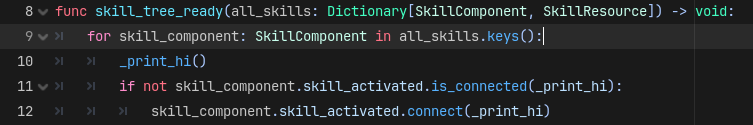

# Goals/Tasks

My main tasks for the week were further work on implementing skill trees into the game and getting the curves to infinitely scale. Aside from that, I spent some time on refactoring.

## Skill Tree Implementation

Unfortunately, my work in this area didn't result in any commits this week. I spent 2-3 hours debugging the skill tree implementation because skills couldn't be activated if the skill tree was added to the upgrade area scene programmatically. I discovered a bug in which the for loop in the `GlobalPlayerManager` doesn't progress into the inside lines of the for loop itself. I brought this up to my team when I discovered it, but we haven't figured out why it's occuring yet. Here's a screenshot of the place where the loop isn't progressing (everything after line 9 is ignored): 

In addition to the debugging, I worked closely with Kat to connect the skill trees to the `GlobalPlayerManager`, although the commits are all hers since she had to be careful that we didn't break anything due to the use of tool scripts.

Finally, I spent some time trying to learn how to connect the skill tree system that Kat and I had worked on with Xander's ability system. Unfortunately, it seemed that the two systems were too different to integrate with each other (although after talking with Xander again, they might not actually clash too much), and that at times we had basically done duplicate work with different approaches. I can only assume this was due to a communication issue, despite the fact that the whole team tried to be explicitly clear about what they were working on, with Kat and I working on the skill trees and Xander on the in-run upgrades. I think the issue stemmed from a misunderstanding about leaving mid-run upgrades as only stat upgrades and post-run upgrades as ability upgrades, specifically in that the mid-run upgrades were implemented with not just stat upgrades but also ability upgrades instead of separating the two. In implementing mid-run ability upgrades, Xander created a system for those ability upgrades which was essentially what Kat and I were doing for meta progression, except implemented differently.

## Infinite Scaling (Curves)

Here I actually made some tangible progress. After revisting the website Dr. Faas had suggested a few weeks ago, something clicked and I finally understood how I could use this infinitely. The main issue I had initially had was that I wanted to use a curve that eased both in and out, so that the difficulty wouldn't eventually spike to obscene amounts and so there would be some "downtime," in terms of difficulty increasing, every few waves. In this case, even with a function that calculated wave points instead of baking a Godot Curve, I needed some way of getting a halfway point, which meant that an upper limit was required. I finally figured out that I could easily set the upper limit as a variable which *also* scales, so the [curve keeps repeating infinitely](https://github.com/KxtR-27/CS414_VipWaveSurvival/commit/d8289471d7cef4d96f504f5c97318f382b559e96). I might have to revisit how I scale that upper limit, as it currently increases each time it hits that upper bound and resets, when it might actually help to have that upper limit decrease (or increase and decrease at various increments), so that the difficulty scaling gets faster as the wave count reaches extremely high numbers. Regardless, the infinite scaling is finally implemented properly, now it's just a matter of tweaking numbers here and there for game balance.

# Estimated v.s. Actual Time

I worked for 6+ hours this week without accomplishing much that was tangible unfortunately. Therefore, my actual time for most tasks exceeded the time I estimated they would take.

# Communication

Clearly, as evidenced by the issue with the ability upgrades, our communication has not been great recently, or at least has taken a hit. I believe part of that is due to the fact that not everyone communicates on Discord an equal amount (and in general we haven't been chatting as much in our channel), and that any time one person is missing in class or is otherwise unable to work, inevitably they are left out of the loop unless the topics discussed are also mentioned on Discord.